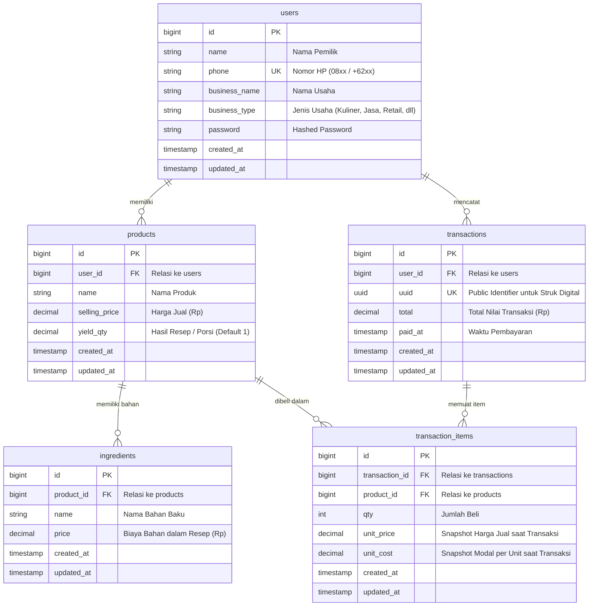

# Dokumentasi API UntungApp (GTNIC 2026)

Dokumentasi rancangan REST API dan Entity Relationship Diagram (ERD) untuk aplikasi UntungApp sesuai spesifikasi `docs/BRIEF.md`.

---

## 1. Entity Relationship Diagram (ERD)

### Visualisasi Relasi (Mermaid)



### Aturan Relasi & Integritas Data
1. **Multi-tenant / User Scoping**: Seluruh `products` dan `transactions` terikat pada `user_id`. Query data wajib dibatasi hanya untuk user yang sedang login (lewat Global Scope / Policy).
2. **Cascade Deletion**:
   - Menghapus `products` otomatis menghapus `ingredients` terkait (`onDelete('cascade')`).
   - Menghapus `transactions` otomatis menghapus `transaction_items` terkait (`onDelete('cascade')`).
3. **Snapshot Integrity**:
   - `transaction_items` menyimpan snapshot `unit_price` dan `unit_cost` pada detik transaksi dicatat.
   - Jika harga jual produk atau biaya bahan pada `ingredients` berubah di masa mendatang, rekam jejak keuangan lama tetap 100% konsisten dan akurat.

---

## 2. Standar Desain API

- **Base URL**: `http://localhost:8000/api` (Development)
- **Autentikasi**: Laravel Sanctum via header `Authorization: Bearer <token>`
- **Format Header Request**:
  ```http
  Accept: application/json
  Content-Type: application/json
  ```
- **Format Response Sukses**:
  ```json
  {
    "message": "Pesan sukses dalam bahasa Indonesia ramah",
    "data": {}
  }
  ```
- **Format Response Error**:
  ```json
  {
    "message": "Pesan error dalam bahasa Indonesia ramah",
    "errors": {
      "field_name": [
        "Penjelasan validasi error"
      ]
    }
  }
  ```

---

## 3. Daftar Endpoint (Fitur 1 - 6)

### Fitur 1: Autentikasi & Profil Usaha

#### 1. `POST /api/register`
Mendaftarkan akun pemilik usaha baru.

- **Request Body**:
```json
{
  "name": "Budi Santoso",
  "phone": "081234567890",
  "business_name": "Kopi Senja Bahagia",
  "business_type": "Kuliner & Minuman",
  "password": "rahasia123",
  "password_confirmation": "rahasia123"
}
```

- **Response `201 Created`**:
```json
{
  "message": "Pendaftaran berhasil! Selamat datang di UntungApp.",
  "data": {
    "user": {
      "id": 1,
      "name": "Budi Santoso",
      "phone": "081234567890",
      "business_name": "Kopi Senja Bahagia",
      "business_type": "Kuliner & Minuman"
    },
    "token": "1|sanctum_token_string_here"
  }
}
```

---

#### 2. `POST /api/login`
Masuk dengan nomor HP dan password (dilengkapi Rate Limiting: max 5 percobaan per menit).

- **Request Body**:
```json
{
  "phone": "081234567890",
  "password": "rahasia123"
}
```

- **Response `200 OK`**:
```json
{
  "message": "Berhasil masuk. Selamat beraktivitas!",
  "data": {
    "user": {
      "id": 1,
      "name": "Budi Santoso",
      "phone": "081234567890",
      "business_name": "Kopi Senja Bahagia",
      "business_type": "Kuliner & Minuman"
    },
    "token": "2|sanctum_token_string_here"
  }
}
```

---

#### 3. `GET /api/me`
Melihat profil pengguna yang sedang login.
- **Header**: `Authorization: Bearer <token>`
- **Response `200 OK`**:
```json
{
  "message": "Data profil berhasil dimuat.",
  "data": {
    "id": 1,
    "name": "Budi Santoso",
    "phone": "081234567890",
    "business_name": "Kopi Senja Bahagia",
    "business_type": "Kuliner & Minuman"
  }
}
```

---

#### 4. `POST /api/logout`
Mencabut token sesi yang sedang aktif.
- **Header**: `Authorization: Bearer <token>`
- **Response `200 OK`**:
```json
{
  "message": "Berhasil keluar dari akun.",
  "data": null
}
```

---

### Fitur 2: Produk & Perhitungan HPP (Modal Sebenarnya)

Aturan Domain HPP (`config/hpp.php`):
- `total_modal` = `sum(ingredients.price)`
- `modal_per_unit` = `total_modal / yield_qty`
- `margin_percent` = `((selling_price - modal_per_unit) / selling_price) * 100` (dibulatkan 2 desimal)
- `status`:
  - `rugi`: `margin_percent < 0`
  - `tipis`: `0 <= margin_percent < 20`
  - `sehat`: `margin_percent >= 20`

#### 1. `GET /api/products`
Mengambil daftar produk milik user beserta hasil kalkulasi HPP dan status margin.
- **Header**: `Authorization: Bearer <token>`
- **Response `200 OK`**:
```json
{
  "message": "Daftar produk berhasil dimuat.",
  "data": [
    {
      "id": 1,
      "name": "Es Kopi Susu Gula Aren",
      "selling_price": 18000,
      "yield_qty": 1,
      "ingredients": [
        { "id": 10, "name": "Biji Kopi Espresso 18g", "price": 3500 },
        { "id": 11, "name": "Susu UHT Fresh 120ml", "price": 3000 },
        { "id": 12, "name": "Gula Aren Cair 25ml", "price": 1000 },
        { "id": 13, "name": "Cup, Tutup, Sedotan", "price": 1000 }
      ],
      "total_modal": 8500,
      "modal_per_unit": 8500,
      "margin_percent": 52.78,
      "status": "sehat"
    },
    {
      "id": 2,
      "name": "Brownies Panggang Mini (Resep 1 Loyang = 10 Potong)",
      "selling_price": 5000,
      "yield_qty": 10,
      "ingredients": [
        { "id": 21, "name": "Dark Cooking Chocolate 200g", "price": 22000 },
        { "id": 22, "name": "Tepung Terigu & Gula", "price": 8000 },
        { "id": 23, "name": "Telur 3 Butir & Mentega", "price": 15000 }
      ],
      "total_modal": 45000,
      "modal_per_unit": 4500,
      "margin_percent": 10.0,
      "status": "tipis"
    }
  ]
}
```

---

#### 2. `POST /api/products`
Menambah produk baru beserta daftar bahan bakunya.
- **Header**: `Authorization: Bearer <token>`
- **Request Body**:
```json
{
  "name": "Roti Bakar Cokelat Keju",
  "selling_price": 15000,
  "yield_qty": 1,
  "ingredients": [
    { "name": "Roti Tawar 2 Lembar", "price": 3000 },
    { "name": "Meses Cokelat", "price": 2000 },
    { "name": "Keju Cheddar Parut", "price": 3000 },
    { "name": "Margarin & Susu Kental Manis", "price": 1500 }
  ]
}
```

- **Response `201 Created`**:
```json
{
  "message": "Produk berhasil ditambahkan.",
  "data": {
    "id": 3,
    "name": "Roti Bakar Cokelat Keju",
    "selling_price": 15000,
    "yield_qty": 1,
    "ingredients": [
      { "id": 31, "name": "Roti Tawar 2 Lembar", "price": 3000 },
      { "id": 32, "name": "Meses Cokelat", "price": 2000 },
      { "id": 33, "name": "Keju Cheddar Parut", "price": 3000 },
      { "id": 34, "name": "Margarin & Susu Kental Manis", "price": 1500 }
    ],
    "total_modal": 9500,
    "modal_per_unit": 9500,
    "margin_percent": 36.67,
    "status": "sehat"
  }
}
```

---

#### 3. `GET /api/products/{id}`
Melihat detail satu produk beserta kalkulasi modal dan status margin.
- **Header**: `Authorization: Bearer <token>`
- **Response `200 OK`**:
```json
{
  "message": "Detail produk berhasil dimuat.",
  "data": {
    "id": 1,
    "name": "Es Kopi Susu Gula Aren",
    "selling_price": 18000,
    "yield_qty": 1,
    "ingredients": [
      { "id": 10, "name": "Biji Kopi Espresso 18g", "price": 3500 },
      { "id": 11, "name": "Susu UHT Fresh 120ml", "price": 3000 },
      { "id": 12, "name": "Gula Aren Cair 25ml", "price": 1000 },
      { "id": 13, "name": "Cup, Tutup, Sedotan", "price": 1000 }
    ],
    "total_modal": 8500,
    "modal_per_unit": 8500,
    "margin_percent": 52.78,
    "status": "sehat"
  }
}
```

---

#### 4. `PUT /api/products/{id}`
Memperbarui produk dan daftar bahannya.
- **Header**: `Authorization: Bearer <token>`
- **Request Body**:
```json
{
  "name": "Es Kopi Susu Gula Aren Spesial",
  "selling_price": 20000,
  "yield_qty": 1,
  "ingredients": [
    { "name": "Biji Kopi Espresso 18g", "price": 3500 },
    { "name": "Susu UHT Fresh 120ml", "price": 3200 },
    { "name": "Gula Aren Cair Organik", "price": 1500 },
    { "name": "Cup & Sedotan Bio", "price": 1200 }
  ]
}
```

- **Response `200 OK`**:
```json
{
  "message": "Produk berhasil diperbarui.",
  "data": {
    "id": 1,
    "name": "Es Kopi Susu Gula Aren Spesial",
    "selling_price": 20000,
    "yield_qty": 1,
    "ingredients": [
      { "id": 41, "name": "Biji Kopi Espresso 18g", "price": 3500 },
      { "id": 42, "name": "Susu UHT Fresh 120ml", "price": 3200 },
      { "id": 43, "name": "Gula Aren Cair Organik", "price": 1500 },
      { "id": 44, "name": "Cup & Sedotan Bio", "price": 1200 }
    ],
    "total_modal": 9400,
    "modal_per_unit": 9400,
    "margin_percent": 53.0,
    "status": "sehat"
  }
}
```

---

#### 5. `DELETE /api/products/{id}`
Menghapus produk.
- **Header**: `Authorization: Bearer <token>`
- **Response `200 OK`**:
```json
{
  "message": "Produk berhasil dihapus.",
  "data": null
}
```

---

### Fitur 3: Kasir Sederhana (Catat Penjualan & Snapshot)

#### 1. `POST /api/transactions`
Mencatat penjualan baru. Backend secara otomatis mengambil snapshot `unit_price` dan `unit_cost` produk saat itu juga.
- **Header**: `Authorization: Bearer <token>`
- **Request Body**:
```json
{
  "paid_at": "2026-11-01 10:30:00",
  "items": [
    {
      "product_id": 1,
      "qty": 2
    },
    {
      "product_id": 2,
      "qty": 1
    }
  ]
}
```

- **Response `201 Created`**:
```json
{
  "message": "Transaksi berhasil disimpan.",
  "data": {
    "id": 1,
    "uuid": "8f3b7c2a-9e12-4f33-b412-1d57e84cb123",
    "total": 41000,
    "total_cost": 21500,
    "total_profit": 19500,
    "paid_at": "2026-11-01 10:30:00",
    "receipt_url": "/struk/8f3b7c2a-9e12-4f33-b412-1d57e84cb123",
    "items": [
      {
        "product_id": 1,
        "product_name": "Es Kopi Susu Gula Aren",
        "qty": 2,
        "unit_price": 18000,
        "unit_cost": 8500,
        "subtotal_price": 36000,
        "subtotal_cost": 17000,
        "subtotal_profit": 19000
      },
      {
        "product_id": 2,
        "product_name": "Brownies Panggang Mini",
        "qty": 1,
        "unit_price": 5000,
        "unit_cost": 4500,
        "subtotal_price": 5000,
        "subtotal_cost": 4500,
        "subtotal_profit": 500
      }
    ]
  }
}
```

---

#### 2. `GET /api/transactions`
Riwayat transaksi user yang login.
- **Header**: `Authorization: Bearer <token>`
- **Response `200 OK`**:
```json
{
  "message": "Riwayat transaksi berhasil dimuat.",
  "data": [
    {
      "id": 1,
      "uuid": "8f3b7c2a-9e12-4f33-b412-1d57e84cb123",
      "total": 41000,
      "total_cost": 21500,
      "total_profit": 19500,
      "paid_at": "2026-11-01 10:30:00",
      "items_count": 2
    }
  ]
}
```

---

### Fitur 4: Dashboard Untung-Rugi & Tren 7 Hari

#### 1. `GET /api/dashboard`
Ringkasan untung hari ini, perbandingan tren 7 hari, dan produk untung/rugi.
- **Header**: `Authorization: Bearer <token>`
- **Response `200 OK`**:
```json
{
  "message": "Data dashboard berhasil dimuat.",
  "data": {
    "today": {
      "omset": 540000,
      "modal_sebenarnya": 270000,
      "untung_bersih": 270000,
      "transaksi_count": 18
    },
    "trend_7_days": [
      { "date": "2026-10-26", "omset": 350000, "modal": 180000, "untung": 170000 },
      { "date": "2026-10-27", "omset": 420000, "modal": 210000, "untung": 210000 },
      { "date": "2026-10-28", "omset": 390000, "modal": 195000, "untung": 195000 },
      { "date": "2026-10-29", "omset": 480000, "modal": 240000, "untung": 240000 },
      { "date": "2026-10-30", "omset": 510000, "modal": 250000, "untung": 260000 },
      { "date": "2026-10-31", "omset": 620000, "modal": 300000, "untung": 320000 },
      { "date": "2026-11-01", "omset": 540000, "modal": 270000, "untung": 270000 }
    ],
    "top_profitable_products": [
      { "name": "Es Kopi Susu Gula Aren", "total_profit": 190000, "margin_percent": 52.78 }
    ],
    "unprofitable_or_slim_products": [
      { "name": "Brownies Panggang Mini", "total_profit": 5000, "margin_percent": 10.0, "status": "tipis" }
    ]
  }
}
```

---

#### 2. `GET /api/dashboard/ai-insight`
Saran harian berbasis AI dengan fallback teks terstruktur jika AI offline/timeout.
- **Header**: `Authorization: Bearer <token>`
- **Response `200 OK`**:
```json
{
  "message": "Insight harian berhasil dimuat.",
  "data": {
    "date": "2026-11-01",
    "headline": "Kopi Senja Bahagia Hari Ini Sangat Menguntungkan!",
    "advice": "Penjualan Es Kopi Susu menyumbang 70% dari keuntungan bersihmu hari ini. Tapi perhatikan Brownies Panggang: marginnya cuma 10%. Coba naikkan harga jual 500 perak atau cari supplier cokelat yang lebih hemat agar margin naik ke 25%.",
    "source": "ai_gemini"
  }
}
```

---

### Fitur 5: Struk Digital Publik (Read-Only via UUID)

#### 1. `GET /api/receipts/{uuid}`
Halaman publik struk digital. **Tanpa auth**.
**Penting untuk privasi**: Data modal (`unit_cost`) dan laba/keuntungan bersih (`profit`) **TIDAK PERNAH** dimunculkan pada endpoint ini.
- **Response `200 OK`**:
```json
{
  "message": "Struk belanja ditemukan.",
  "data": {
    "uuid": "8f3b7c2a-9e12-4f33-b412-1d57e84cb123",
    "business_name": "Kopi Senja Bahagia",
    "business_type": "Kuliner & Minuman",
    "paid_at": "2026-11-01 10:30:00",
    "total": 41000,
    "items": [
      {
        "name": "Es Kopi Susu Gula Aren",
        "qty": 2,
        "price": 18000,
        "subtotal": 36000
      },
      {
        "name": "Brownies Panggang Mini",
        "qty": 1,
        "price": 5000,
        "subtotal": 5000
      }
    ],
    "footer_note": "Terima kasih sudah mendukung UMKM lokal!"
  }
}
```

---

### Fitur 6: Skor Kesehatan Usaha (0-100)

#### 1. `GET /api/business-health`
Menampilkan skor kesehatan usaha (0-100) yang dihitung deterministik di backend + narasi evaluasi dari AI / fallback service.
- **Header**: `Authorization: Bearer <token>`
- **Response `200 OK`**:
```json
{
  "message": "Skor kesehatan usaha berhasil dimuat.",
  "data": {
    "score": 82,
    "category": "Sangat Prima",
    "metrics": {
      "margin_health_score": 85,
      "product_profitability_ratio": 90,
      "consistency_score": 75,
      "clean_profit_ratio": 78
    },
    "narrative": "Bisnis Anda berada dalam kondisi prima dengan margin rata-rata di atas 45%. Sebagian besar produk Anda menghasilkan keuntungan nyata dan tidak boncos. Pertahankan stok bahan kopi agar tidak kehabisan saat jam sibuk.",
    "action_items": [
      "Pertahankan harga jual produk unggulan",
      "Evaluasi ulang harga produk dengan margin tipis",
      "Catat penjualan harian secara konsisten setiap tutup kasir"
    ]
  }
}
```
---

## 4. Rencana Implementasi Tahap 1 (Backend Fondasi)

Berikut yang akan diimplementasikan pada Tahap 1 setelah disetujui:
1. **Setup Backend Laravel**:
   - Install/setup project Laravel pada folder `backend/`.
   - Setup Sanctum API token & CORS (support origin dari `.env`).
   - Rate limiting untuk endpoint login (5 attempts/min).
2. **Migrations & Models**:
   - `users`: `name`, `phone` (unik), `business_name`, `business_type`, `password`.
   - `products`: `user_id`, `name`, `selling_price`, `yield_qty` (default 1).
   - `ingredients`: `product_id`, `name`, `price`.
   - `transactions`: `user_id`, `uuid`, `total`, `paid_at`.
   - `transaction_items`: `transaction_id`, `product_id`, `qty`, `unit_price`, `unit_cost`.
3. **Konfigurasi & Service**:
   - `config/hpp.php`: ambang batas status margin (`rugi`, `tipis`, `sehat`).
   - `HppService`: logic hitung total_modal, modal_per_unit, margin_percent, status.
4. **Controllers, FormRequests, & Resources**:
   - `AuthController`: register, login, logout, me.
   - `ProductController`: index, store, show, update, destroy.
   - FormRequests dengan validasi pesan bahasa Indonesia ramah.
   - Scoping data per user: User A tidak bisa melihat atau memanipulasi produk milik User B.
5. **Feature Tests**:
   - Kalkulasi HPP, margin, status (termasuk yield_qty > 1, margin tipis, dan margin negatif/rugi).
   - Pembatasan data antar-user (User A vs User B).
   - Registrasi & Login berhasil dan gagal (validasi, credential salah).
6. **Migrasi & Eksekusi Test**:
   - Menjalankan `php artisan migrate`.
   - Menjalankan seluruh test dan menampilkan hasilnya.
