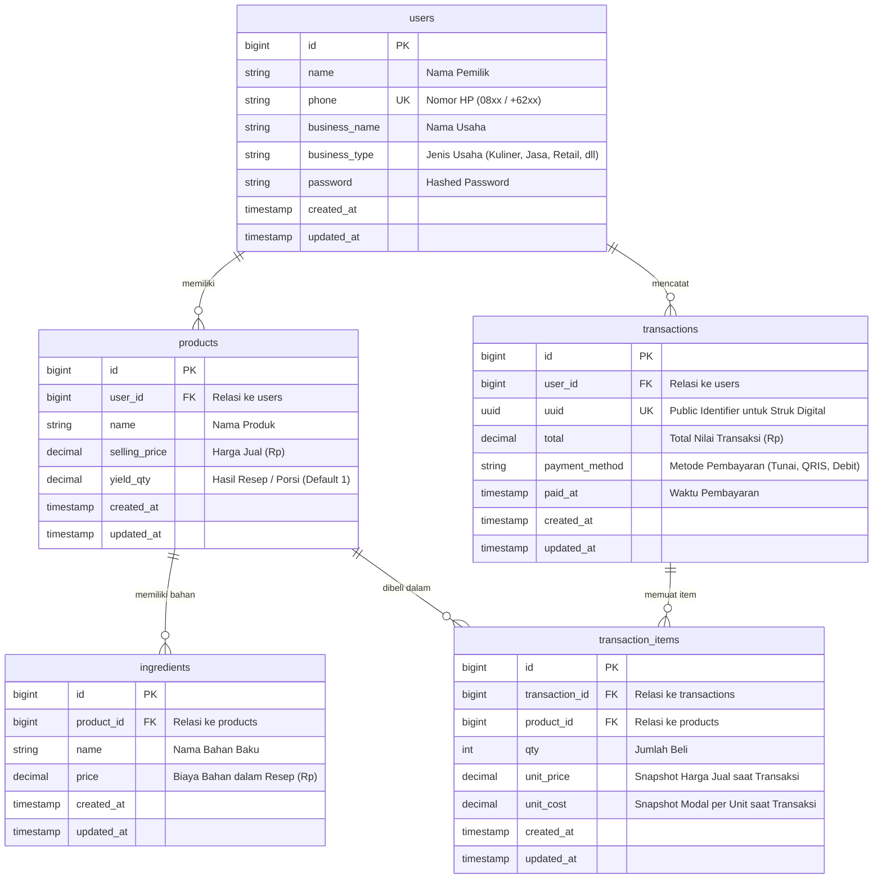

# Dokumentasi API UntungApp (GTNIC 2026)

Dokumentasi rancangan REST API dan Entity Relationship Diagram (ERD) untuk aplikasi UntungApp sesuai spesifikasi `docs/BRIEF.md`.

---

## 1. Entity Relationship Diagram (ERD)

### Visualisasi Relasi (Mermaid)



### Aturan Relasi & Integritas Data
1. **Multi-tenant / User Scoping**: Seluruh `products` dan `transactions` terikat pada `user_id`. Query data wajib dibatasi hanya untuk user yang sedang login (lewat Global Scope / Policy).
2. **Cascade Deletion**:
   - Menghapus `products` otomatis menghapus `ingredients` terkait (`onDelete('cascade')`).
   - Menghapus `transactions` otomatis menghapus `transaction_items` terkait (`onDelete('cascade')`).
3. **Snapshot Integrity**:
   - `transaction_items` menyimpan snapshot `unit_price` dan `unit_cost` pada detik transaksi dicatat.
   - Jika harga jual produk atau biaya bahan pada `ingredients` berubah di masa mendatang, rekam jejak keuangan lama tetap 100% konsisten dan akurat.

---

## 2. Standar Desain API

- **Base URL**: `http://localhost:8000/api` (Development)
- **Autentikasi**: Laravel Sanctum via header `Authorization: Bearer <token>`
- **Format Header Request**:
  ```http
  Accept: application/json
  Content-Type: application/json
  ```
- **Format Response Sukses**:
  ```json
  {
    "message": "Pesan sukses dalam bahasa Indonesia ramah",
    "data": {}
  }
  ```
- **Format Response Error**:
  ```json
  {
    "message": "Pesan error dalam bahasa Indonesia ramah",
    "errors": {
      "field_name": [
        "Penjelasan validasi error"
      ]
    }
  }
  ```

---

## 3. Daftar Endpoint (Fitur 1 - 6)

### Fitur 1: Autentikasi & Profil Usaha

#### 1. `POST /api/register`
Mendaftarkan akun pemilik usaha baru.

- **Request Body**:
```json
{
  "name": "Budi Santoso",
  "phone": "081234567890",
  "business_name": "Kopi Senja Bahagia",
  "business_type": "Kuliner & Minuman",
  "password": "rahasia123",
  "password_confirmation": "rahasia123"
}
```

- **Response `201 Created`**:
```json
{
  "message": "Pendaftaran berhasil! Selamat datang di UntungApp.",
  "data": {
    "user": {
      "id": 1,
      "name": "Budi Santoso",
      "phone": "081234567890",
      "business_name": "Kopi Senja Bahagia",
      "business_type": "Kuliner & Minuman"
    },
    "token": "1|sanctum_token_string_here"
  }
}
```

---

#### 2. `POST /api/login`
Masuk dengan nomor HP dan password (dilengkapi Rate Limiting: max 5 percobaan per menit).

- **Request Body**:
```json
{
  "phone": "081234567890",
  "password": "rahasia123"
}
```

- **Response `200 OK`**:
```json
{
  "message": "Berhasil masuk. Selamat beraktivitas!",
  "data": {
    "user": {
      "id": 1,
      "name": "Budi Santoso",
      "phone": "081234567890",
      "business_name": "Kopi Senja Bahagia",
      "business_type": "Kuliner & Minuman"
    },
    "token": "2|sanctum_token_string_here"
  }
}
```

---

#### 3. `GET /api/me`
Melihat profil pengguna yang sedang login.
- **Header**: `Authorization: Bearer <token>`
- **Response `200 OK`**:
```json
{
  "message": "Data profil berhasil dimuat.",
  "data": {
    "id": 1,
    "name": "Budi Santoso",
    "phone": "081234567890",
    "business_name": "Kopi Senja Bahagia",
    "business_type": "Kuliner & Minuman"
  }
}
```

---

#### 4. `POST /api/logout`
Mencabut token sesi yang sedang aktif.
- **Header**: `Authorization: Bearer <token>`
- **Response `200 OK`**:
```json
{
  "message": "Berhasil keluar dari akun.",
  "data": null
}
```

---

### Fitur 2: Produk & Perhitungan HPP (Modal Sebenarnya)

Aturan Domain HPP (`config/hpp.php`):
- `total_modal` = `sum(ingredients.price)`
- `modal_per_unit` = `total_modal / yield_qty`
- `margin_percent` = `((selling_price - modal_per_unit) / selling_price) * 100` (dibulatkan 2 desimal)
- `status`:
  - `rugi`: `margin_percent < 0`
  - `tipis`: `0 <= margin_percent < 20`
  - `sehat`: `margin_percent >= 20`

#### 1. `GET /api/products`
Mengambil daftar produk milik user beserta hasil kalkulasi HPP dan status margin.
- **Header**: `Authorization: Bearer <token>`
- **Response `200 OK`**:
```json
{
  "message": "Daftar produk berhasil dimuat.",
  "data": [
    {
      "id": 1,
      "name": "Es Kopi Susu Gula Aren",
      "selling_price": 18000,
      "yield_qty": 1,
      "ingredients": [
        { "id": 10, "name": "Biji Kopi Espresso 18g", "price": 3500 },
        { "id": 11, "name": "Susu UHT Fresh 120ml", "price": 3000 },
        { "id": 12, "name": "Gula Aren Cair 25ml", "price": 1000 },
        { "id": 13, "name": "Cup, Tutup, Sedotan", "price": 1000 }
      ],
      "total_modal": 8500,
      "modal_per_unit": 8500,
      "margin_percent": 52.78,
      "status": "sehat"
    },
    {
      "id": 2,
      "name": "Brownies Panggang Mini (Resep 1 Loyang = 10 Potong)",
      "selling_price": 5000,
      "yield_qty": 10,
      "ingredients": [
        { "id": 21, "name": "Dark Cooking Chocolate 200g", "price": 22000 },
        { "id": 22, "name": "Tepung Terigu & Gula", "price": 8000 },
        { "id": 23, "name": "Telur 3 Butir & Mentega", "price": 15000 }
      ],
      "total_modal": 45000,
      "modal_per_unit": 4500,
      "margin_percent": 10.0,
      "status": "tipis"
    }
  ]
}
```

---

#### 2. `POST /api/products`
Menambah produk baru beserta daftar bahan bakunya.
- **Header**: `Authorization: Bearer <token>`
- **Request Body**:
```json
{
  "name": "Roti Bakar Cokelat Keju",
  "selling_price": 15000,
  "yield_qty": 1,
  "ingredients": [
    { "name": "Roti Tawar 2 Lembar", "price": 3000 },
    { "name": "Meses Cokelat", "price": 2000 },
    { "name": "Keju Cheddar Parut", "price": 3000 },
    { "name": "Margarin & Susu Kental Manis", "price": 1500 }
  ]
}
```

- **Response `201 Created`**:
```json
{
  "message": "Produk berhasil ditambahkan.",
  "data": {
    "id": 3,
    "name": "Roti Bakar Cokelat Keju",
    "selling_price": 15000,
    "yield_qty": 1,
    "ingredients": [
      { "id": 31, "name": "Roti Tawar 2 Lembar", "price": 3000 },
      { "id": 32, "name": "Meses Cokelat", "price": 2000 },
      { "id": 33, "name": "Keju Cheddar Parut", "price": 3000 },
      { "id": 34, "name": "Margarin & Susu Kental Manis", "price": 1500 }
    ],
    "total_modal": 9500,
    "modal_per_unit": 9500,
    "margin_percent": 36.67,
    "status": "sehat"
  }
}
```

---

#### 3. `GET /api/products/{id}`
Melihat detail satu produk beserta kalkulasi modal dan status margin.
- **Header**: `Authorization: Bearer <token>`
- **Response `200 OK`**:
```json
{
  "message": "Detail produk berhasil dimuat.",
  "data": {
    "id": 1,
    "name": "Es Kopi Susu Gula Aren",
    "selling_price": 18000,
    "yield_qty": 1,
    "ingredients": [
      { "id": 10, "name": "Biji Kopi Espresso 18g", "price": 3500 },
      { "id": 11, "name": "Susu UHT Fresh 120ml", "price": 3000 },
      { "id": 12, "name": "Gula Aren Cair 25ml", "price": 1000 },
      { "id": 13, "name": "Cup, Tutup, Sedotan", "price": 1000 }
    ],
    "total_modal": 8500,
    "modal_per_unit": 8500,
    "margin_percent": 52.78,
    "status": "sehat"
  }
}
```

---

#### 4. `PUT /api/products/{id}`
Memperbarui produk dan daftar bahannya.
- **Header**: `Authorization: Bearer <token>`
- **Request Body**:
```json
{
  "name": "Es Kopi Susu Gula Aren Spesial",
  "selling_price": 20000,
  "yield_qty": 1,
  "ingredients": [
    { "name": "Biji Kopi Espresso 18g", "price": 3500 },
    { "name": "Susu UHT Fresh 120ml", "price": 3200 },
    { "name": "Gula Aren Cair Organik", "price": 1500 },
    { "name": "Cup & Sedotan Bio", "price": 1200 }
  ]
}
```

- **Response `200 OK`**:
```json
{
  "message": "Produk berhasil diperbarui.",
  "data": {
    "id": 1,
    "name": "Es Kopi Susu Gula Aren Spesial",
    "selling_price": 20000,
    "yield_qty": 1,
    "ingredients": [
      { "id": 41, "name": "Biji Kopi Espresso 18g", "price": 3500 },
      { "id": 42, "name": "Susu UHT Fresh 120ml", "price": 3200 },
      { "id": 43, "name": "Gula Aren Cair Organik", "price": 1500 },
      { "id": 44, "name": "Cup & Sedotan Bio", "price": 1200 }
    ],
    "total_modal": 9400,
    "modal_per_unit": 9400,
    "margin_percent": 53.0,
    "status": "sehat"
  }
}
```

---

#### 5. `DELETE /api/products/{id}`
Menghapus produk.
- **Header**: `Authorization: Bearer <token>`
- **Response `200 OK`**:
```json
{
  "message": "Produk berhasil dihapus.",
  "data": null
}
```

---

#### 6. `GET /api/products/{id}/advice`
Meminta rekomendasi harga jual cerdas dari **Gemini AI** (atau fallback aturan margin sehat jika AI offline/timeout/tanpa key). Dilindungi otentikasi Sanctum dan isolasi data per user. Respons di-cache selama 6 jam per user dan hash data produk.
- **Header**: `Authorization: Bearer <token>`
- **Response `200 OK` (Sumber AI)**:
```json
{
  "message": "Saran harga produk berhasil dimuat.",
  "data": {
    "headline": "Saran Harga Gemini: Croissant Coklat",
    "text": "Harga jual Rp25.000 sudah menghasilkan margin 28% yang tergolong sehat. Anda bisa tetap mempertahankan harga ini untuk menjaga loyalitas pelanggan.",
    "source": "ai",
    "product_id": 1,
    "selling_price": 25000,
    "modal_per_unit": 18000,
    "margin_percent": 28,
    "status": "sehat"
  }
}
```
- **Response `200 OK` (Sumber Fallback / Aturan Heuristik)**:
```json
{
  "message": "Saran harga produk berhasil dimuat.",
  "data": {
    "headline": "Rekomendasi Naikkan Harga: Nasi Goreng Rugi",
    "text": "Harga jual Rp10.000 berada di bawah modal Rp13.000 (-30.0%). Naikkan harga jual ke minimal Rp16.500 agar mencapai batas margin sehat 20%.",
    "source": "fallback",
    "product_id": 2,
    "selling_price": 10000,
    "modal_per_unit": 13000,
    "margin_percent": -30,
    "status": "rugi"
  }
}
```
- **Response `404 Not Found`**: Jika produk bukan milik user yang sedang terautentikasi.

---

### Fitur 3: Kasir Sederhana (Catat Penjualan & Snapshot)

#### 1. `POST /api/transactions`
Mencatat penjualan baru. Backend secara otomatis mengambil snapshot `unit_price` dan `unit_cost` produk saat itu juga.
- **Header**: `Authorization: Bearer <token>`
- **Request Body**:
```json
{
  "paid_at": "2026-11-01 10:30:00",
  "items": [
    {
      "product_id": 1,
      "qty": 2
    },
    {
      "product_id": 2,
      "qty": 1
    }
  ]
}
```

- **Response `201 Created`**:
```json
{
  "message": "Transaksi berhasil disimpan.",
  "data": {
    "id": 1,
    "uuid": "8f3b7c2a-9e12-4f33-b412-1d57e84cb123",
    "total": 41000,
    "total_cost": 21500,
    "total_profit": 19500,
    "paid_at": "2026-11-01 10:30:00",
    "receipt_url": "/struk/8f3b7c2a-9e12-4f33-b412-1d57e84cb123",
    "items": [
      {
        "product_id": 1,
        "product_name": "Es Kopi Susu Gula Aren",
        "qty": 2,
        "unit_price": 18000,
        "unit_cost": 8500,
        "subtotal_price": 36000,
        "subtotal_cost": 17000,
        "subtotal_profit": 19000
      },
      {
        "product_id": 2,
        "product_name": "Brownies Panggang Mini",
        "qty": 1,
        "unit_price": 5000,
        "unit_cost": 4500,
        "subtotal_price": 5000,
        "subtotal_cost": 4500,
        "subtotal_profit": 500
      }
    ]
  }
}
```

---

#### 2. `GET /api/transactions`
Riwayat transaksi user yang login dengan filter tanggal (default hari ini).
- **Header**: `Authorization: Bearer <token>`
- **Query Params**:
  - `date`: `YYYY-MM-DD` (opsional, default: tanggal hari ini `now()->toDateString()`), atau `all` untuk seluruh riwayat.
- **Response `200 OK`**:
```json
{
  "message": "Riwayat transaksi berhasil dimuat.",
  "data": [
    {
      "id": 1,
      "uuid": "8f3b7c2a-9e12-4f33-b412-1d57e84cb123",
      "total": 41000,
      "total_cost": 21500,
      "profit": 19500,
      "total_profit": 19500,
      "paid_at": "2026-11-01T10:30:00.000000Z",
      "receipt_url": "/struk/8f3b7c2a-9e12-4f33-b412-1d57e84cb123",
      "items_count": 2,
      "items": [
        {
          "id": 1,
          "product_id": 1,
          "product_name": "Es Kopi Susu Gula Aren",
          "qty": 2,
          "unit_price": 18000,
          "unit_cost": 8500,
          "subtotal_price": 36000,
          "subtotal_cost": 17000,
          "subtotal_profit": 19000
        }
      ]
    }
  ]
}
```

---

#### 3. `GET /api/transactions/{id}`
Melihat detail satu transaksi beserta rincian item, snapshot harga, modal, dan profit transaksi.
- **Header**: `Authorization: Bearer <token>`
- **Parameter URL**: `id` (numeric ID atau UUID string)
- **Response `200 OK`**:
```json
{
  "message": "Detail transaksi berhasil dimuat.",
  "data": {
    "id": 1,
    "uuid": "8f3b7c2a-9e12-4f33-b412-1d57e84cb123",
    "total": 41000,
    "total_cost": 21500,
    "profit": 19500,
    "total_profit": 19500,
    "paid_at": "2026-11-01T10:30:00.000000Z",
    "receipt_url": "/struk/8f3b7c2a-9e12-4f33-b412-1d57e84cb123",
    "items_count": 2,
    "items": [
      {
        "id": 1,
        "product_id": 1,
        "product_name": "Es Kopi Susu Gula Aren",
        "qty": 2,
        "unit_price": 18000,
        "unit_cost": 8500,
        "subtotal_price": 36000,
        "subtotal_cost": 17000,
        "subtotal_profit": 19000
      },
      {
        "id": 2,
        "product_id": 2,
        "product_name": "Brownies Panggang Mini",
        "qty": 1,
        "unit_price": 5000,
        "unit_cost": 4500,
        "subtotal_price": 5000,
        "subtotal_cost": 4500,
        "subtotal_profit": 500
      }
    ]
  }
}
```

---

### Fitur 4: Dashboard Untung-Rugi & Tren 7 Hari

#### 1. `GET /api/dashboard/stats` (Alias: `GET /api/dashboard`)
Statistik ringkasan keuntungan harian, tren performa 7 hari terakhir, evaluasi produk (rugi di urutan teratas), dan rekomendasi pintar berbasis aturan untuk user yang login.
- **Header**: `Authorization: Bearer <token>`
- **Response `200 OK`**:
```json
{
  "message": "Data statistik dashboard berhasil dimuat.",
  "data": {
    "today": {
      "omzet": 540000,
      "laba": 270000,
      "untung_bersih": 270000,
      "modal": 270000,
      "modal_sebenarnya": 270000,
      "transaksi_count": 18,
      "jumlah_transaksi": 18,
      "margin_rata_rata": 50.0
    },
    "trend": [
      {
        "date": "2026-11-01",
        "omzet": 350000,
        "modal": 180000,
        "laba": 170000,
        "transaksi_count": 8
      },
      {
        "date": "2026-11-02",
        "omzet": 420000,
        "modal": 210000,
        "laba": 210000,
        "transaksi_count": 10
      },
      {
        "date": "2026-11-03",
        "omzet": 390000,
        "modal": 195000,
        "laba": 195000,
        "transaksi_count": 9
      },
      {
        "date": "2026-11-04",
        "omzet": 480000,
        "modal": 240000,
        "laba": 240000,
        "transaksi_count": 12
      },
      {
        "date": "2026-11-05",
        "omzet": 510000,
        "modal": 250000,
        "laba": 260000,
        "transaksi_count": 14
      },
      {
        "date": "2026-11-06",
        "omzet": 620000,
        "modal": 300000,
        "laba": 320000,
        "transaksi_count": 16
      },
      {
        "date": "2026-11-07",
        "omzet": 540000,
        "modal": 270000,
        "laba": 270000,
        "transaksi_count": 18
      }
    ],
    "products": [
      {
        "id": 7,
        "name": "Croissant Cokelat Butter",
        "selling_price": 10000,
        "yield_qty": 1,
        "total_modal": 11000,
        "modal_per_unit": 11000,
        "margin_percent": -10.0,
        "status": "rugi"
      },
      {
        "id": 6,
        "name": "Brownies Panggang Mini",
        "selling_price": 12000,
        "yield_qty": 1,
        "total_modal": 10700,
        "modal_per_unit": 10700,
        "margin_percent": 10.83,
        "status": "tipis"
      },
      {
        "id": 1,
        "name": "Kopi Susu Gula Aren",
        "selling_price": 18000,
        "yield_qty": 1,
        "total_modal": 8500,
        "modal_per_unit": 8500,
        "margin_percent": 52.78,
        "status": "sehat"
      }
    ],
    "insight": {
      "headline": "Perhatian: Ada Menu Rugi!",
      "text": "Menu 'Croissant Cokelat Butter' saat ini memiliki margin minus (-10.0%). Segera naikkan harga jual atau kurangi takaran bahan baku agar modal tertutup.",
      "source": "fallback"
    }
  }
}
```

---

#### Integrasi Gemini AI pada Dashboard & Artisan CLI

1. **Daily Insight**: Field `data.insight` pada `GET /api/dashboard/stats` dievaluasi melalui `AiInsightService::dailyInsight`.
   - Header API: `x-goog-api-key: <key>`.
   - Timeout: 8 detik.
   - Temperature: 0.4, Max Output Tokens: 800.
   - Tanpa PII: Hanya angka ringkasan omzet, laba, margin rata-rata, dan status 5 produk kunci.
   - Cache: 6 jam per user dan hash data ringkasan.
   - Sumber: `"ai"` jika Gemini merespons berhasil, atau `"fallback"` jika API key tidak diset, timeout, atau terjadi error.

2. **Artisan CLI**:
   - `php artisan ai:models`: Memanggil `GET /v1beta/models` dengan header `x-goog-api-key` dan menampilkan daftar model yang mendukung `generateContent` tanpa prefix `models/`.
   - `php artisan ai:ping`: Melakukan ping ringan menggunakan model yang dikonfigurasi (`GEMINI_MODEL`), menampilkan status HTTP, pesan error mentah yang disanitasi (tanpa mengekspos API key), dan apakah hasilnya `"ai"` atau `"fallback"`.

---

### Fitur 5: Struk Digital Publik (Read-Only via UUID)

#### 1. `GET /api/public/receipts/{uuid}` (Alias: `GET /api/receipts/{uuid}`)
Halaman publik struk digital belanja pelanggan. **Tanpa autentikasi** dan dilindungi rate limiting **throttle 60 request per menit**.
**Penting untuk privasi & keamanan data**: Data modal (`unit_cost`), laba bersih (`profit`), nomor HP pemilik (`phone`), ID database internal (`id`, `user_id`, `product_id`), maupun data user lain **TIDAK PERNAH** dimunculkan pada endpoint ini.
- **Response `200 OK`**:
```json
{
  "message": "Struk belanja ditemukan.",
  "data": {
    "business_name": "Kedai Kopi Barokah",
    "paid_at": "2026-11-01T10:30:00.000000Z",
    "date": "2026-11-01 10:30:00",
    "items": [
      {
        "name": "Es Kopi Susu Gula Aren",
        "qty": 2,
        "unit_price": 18000,
        "price": 18000,
        "subtotal": 36000
      },
      {
        "name": "Brownies Panggang Mini",
        "qty": 1,
        "unit_price": 5000,
        "price": 5000,
        "subtotal": 5000
      }
    ],
    "total": 41000
  }
}
```
- **Response `404 Not Found`** (UUID tidak dikenal atau salah):
```json
{
  "message": "Struk belanja tidak ditemukan atau tautan sudah tidak valid."
}
```
- **Response `429 Too Many Requests`** (Melebihi 60 request per menit).

---

### Fitur 6: Skor Kesehatan Usaha (0-100)

#### 1. `GET /api/health-score` (Alias: `GET /api/business-health`)
Menampilkan skor kesehatan usaha (0-100) per user yang dihitung secara deterministik di backend sesuai konfigurasi `config/health.php` dan narasi evaluasi dari `AiInsightService`.
- **Header**: `Authorization: Bearer <token>`
- **Rumus Penilaian (Total 100 Poin)**:
  1. **Margin Rata-rata Tertimbang Penjualan (40 poin)**: Dihitung dari seluruh penjualan kasir `(Total Laba / Total Omzet) * 100`, dengan target margin 40%.
  2. **Konsistensi Penjualan 14 Hari Terakhir (30 poin)**: Proporsi jumlah hari aktif bertransaksi dalam rentang 14 hari terakhir `(Hari Aktif / 14) * 30`.
  3. **Proporsi Produk Berstatus Sehat (30 poin)**: Persentase produk dengan margin sehat (>= 20%) dari seluruh katalog `(Produk Sehat / Total Produk) * 30`.
- **Response `200 OK` (Ada Data & Gemini AI Aktif)**:
```json
{
  "message": "Skor kesehatan usaha berhasil dimuat.",
  "data": {
    "score": 70,
    "label": "Sehat",
    "alasan": [
      "Margin rata-rata tertimbang penjualan Anda berada di angka 50.0% (menyumbang 40 dari 40 poin).",
      "Toko Anda aktif mencatat penjualan pada 7 dari 14 hari terakhir (menyumbang 15 dari 30 poin).",
      "Sebanyak 1 dari 2 produk (50.0%) berstatus sehat dan menghasilkan untung aman (menyumbang 15 dari 30 poin)."
    ],
    "saran": [
      "Evaluasi takaran bahan baku atau sesuaikan harga jual pada menu yang marginnya tipis atau merugi.",
      "Tingkatkan konsistensi pencatatan transaksi kasir setiap hari agar performa keuangan terpantau secara penuh.",
      "Pantau harga beli bahan baku secara berkala agar lonjakan inflasi tidak menggerus laba bersih Anda."
    ],
    "narasi": "Performa bisnis kedai Anda sangat prima dengan marjin yang kuat. Pertahankan pencatatan transaksi setiap hari agar pertumbuhan stabil.",
    "source": "ai",
    "breakdown": {
      "margin_score": 40,
      "consistency_score": 15,
      "healthy_product_score": 15,
      "weighted_margin": 50,
      "active_days_14": 7,
      "healthy_products_ratio": 50
    }
  }
}
```
- **Response `200 OK` (Data Kosong - Belum ada Produk/Transaksi)**:
```json
{
  "message": "Skor kesehatan usaha berhasil dimuat.",
  "data": {
    "score": 0,
    "label": "Kritis",
    "alasan": [
      "Belum ada transaksi penjualan kasir yang tercatat.",
      "Belum ada produk aktif dengan racikan HPP di sistem katalog."
    ],
    "saran": [
      "Tambahkan menu produk dan rincian biaya bahan baku di menu Katalog & HPP.",
      "Buka menu Kasir untuk mulai mencatat transaksi penjualan harian Anda."
    ],
    "narasi": "Belum ada aktivitas bisnis yang cukup untuk dianalisis. Masukkan produk di menu Katalog & HPP serta catat transaksi pertama Anda di menu Kasir.",
    "source": "fallback",
    "breakdown": {
      "margin_score": 0,
      "consistency_score": 0,
      "healthy_product_score": 0,
      "weighted_margin": 0,
      "active_days_14": 0,
      "healthy_products_ratio": 0
    }
  }
}
```
---

## 4. Rencana Implementasi Tahap 1 (Backend Fondasi)

Berikut yang akan diimplementasikan pada Tahap 1 setelah disetujui:
1. **Setup Backend Laravel**:
   - Install/setup project Laravel pada folder `backend/`.
   - Setup Sanctum API token & CORS (support origin dari `.env`).
   - Rate limiting untuk endpoint login (5 attempts/min).
2. **Migrations & Models**:
   - `users`: `name`, `phone` (unik), `business_name`, `business_type`, `password`.
   - `products`: `user_id`, `name`, `selling_price`, `yield_qty` (default 1).
   - `ingredients`: `product_id`, `name`, `price`.
   - `transactions`: `user_id`, `uuid`, `total`, `payment_method`, `paid_at`.
   - `transaction_items`: `transaction_id`, `product_id`, `qty`, `unit_price`, `unit_cost`.
3. **Konfigurasi & Service**:
   - `config/hpp.php`: ambang batas status margin (`rugi`, `tipis`, `sehat`).
   - `HppService`: logic hitung total_modal, modal_per_unit, margin_percent, status.
4. **Controllers, FormRequests, & Resources**:
   - `AuthController`: register, login, logout, me.
   - `ProductController`: index, store, show, update, destroy.
   - `AiChatController`: chat interaktif tanya jawab finansial bisnis UMKM dengan Gemini AI (`POST /api/ai/chat`).
   - FormRequests dengan validasi pesan bahasa Indonesia ramah.
   - Scoping data per user: User A tidak bisa melihat atau memanipulasi produk milik User B.
5. **Feature Tests**:
   - Kalkulasi HPP, margin, status (termasuk yield_qty > 1, margin tipis, dan margin negatif/rugi).
   - Pembatasan data antar-user (User A vs User B).
   - Registrasi & Login berhasil dan gagal (validasi, credential salah).
6. **Migrasi & Eksekusi Test**:
   - Menjalankan `php artisan migrate`.
   - Menjalankan seluruh test dan menampilkan hasilnya.

---

### 7. Konsultasi Bisnis Interaktif: `POST /api/ai/chat`
Konsultasi interaktif seputar keuangan, strategi harga, dan peningkatan laba usaha UMKM yang diintegrasikan langsung dengan konteks data toko (nama usaha, omzet harian, status katalog produk) dan model Google Gemini AI.

- **URL**: `POST /api/ai/chat`
- **Middleware**: `auth:sanctum`, `throttle:30,1` (maksimal 30 request per menit per user)
- **Header**: `Authorization: Bearer <token>`, `Accept: application/json`
- **Request Body**:
```json
{
  "message": "Bagaimana cara menaikkan margin keuntungan usaha saya tanpa kehilangan pelanggan?"
}
```
- **Response `200 OK` (Gemini AI)**:
```json
{
  "message": "Respon AI berhasil diperoleh.",
  "data": {
    "reply": "Untuk meningkatkan margin tanpa membebani pelanggan, terapkan strategi bundling menu signature Anda dengan minuman bersuhu dingin. Selain itu, lakukan standarisasi takaran resep agar tidak ada pemborosan bahan baku harian.",
    "source": "gemini"
  }
}
```
- **Response `200 OK` (Fallback Cerdas jika Kuota/Jaringan Offline)**:
```json
{
  "message": "Respon AI berhasil diperoleh.",
  "data": {
    "reply": "💡 Saran Margin: Periksa produk Anda yang berstatus margin tipis di menu Katalog & HPP. Naikkan harga Rp1.000 - Rp2.000 atau lakukan negosiasi harga bahan baku dengan supplier.",
    "source": "fallback"
  }
}
```
- **Response `422 Unprocessable Content` (Validasi Gagal)**:
```json
{
  "message": "Pesan untuk asisten AI tidak boleh kosong.",
  "errors": {
    "message": [
      "Pesan untuk asisten AI tidak boleh kosong."
    ]
  }
}
```
